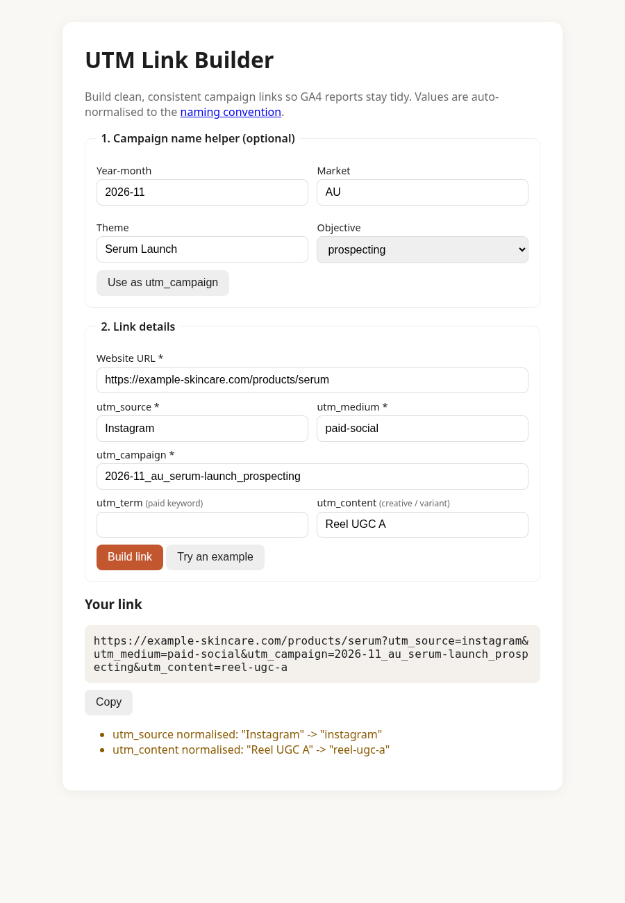

# UTM Link Builder for DTC & SaaS campaigns

A tiny, zero-dependency web tool that builds clean UTM-tagged links and enforces a
consistent campaign naming convention, so GA4 channel and campaign reports stay accurate.



## The problem

DTC brands and SaaS teams launch a lot of campaigns across Meta, Google, email, influencers
and packaging inserts. When every person tags links differently (`Facebook` vs `facebook` vs `fb`,
`paid social` vs `paid-social`), GA4 splits the same traffic into several rows or drops it into
**Unassigned**, and nobody trusts the attribution numbers.

## The approach

* **One naming convention** ([NAMING-CONVENTION.md](NAMING-CONVENTION.md)): lowercase, hyphens inside
  values, underscores between fields, campaign pattern `yyyy-mm_market_theme_objective`.
* **Auto-normalisation**: `"Reel UGC A"` becomes `reel-ugc-a`, and the tool tells you what it changed.
* **Guardrails**: required fields, URL validation, existing UTMs replaced (not duplicated), and a
  warning when `utm_medium` isn't one GA4's default channel grouping expects.
* **Campaign-name helper**: pick month, market, theme and objective and get a consistent name.

## How to run

No install or build step needed.

```bash
git clone https://github.com/yashsarkar1806-creator/utm-builder.git
cd utm-builder
open index.html          # macOS (or just double-click the file)
```

Click **Try an example** to load a sample DTC product-launch link, or open `index.html?demo=1`.

Run the tests (Node 18+):

```bash
npm test
# All UTM tests passed
```

## Sample output

Input: Instagram Reels ad for a (fictional) skincare brand's serum launch in Australia, Nov 2026.

```
https://example-skincare.com/products/serum?utm_source=instagram&utm_medium=paid-social&utm_campaign=2026-11_au_serum-launch_prospecting&utm_content=reel-ugc-a
```

More DTC and SaaS examples (abandoned-cart email, SaaS free-trial search ad, LinkedIn feature launch,
packaging QR codes) are in the [naming convention guide](NAMING-CONVENTION.md#examples-dtc-brands-and-saas).

## Files

| File | What it is |
|---|---|
| `index.html` | The builder UI (plain HTML/CSS) |
| `utm.js` | Normalisation, campaign naming and URL-building logic (browser + Node) |
| `NAMING-CONVENTION.md` | The campaign naming guide |
| `tests/utm.test.js` | Unit tests |

## What this shows

* Practical understanding of **campaign tracking and GA4 attribution** (I'm Google Analytics (GA4) and Google Ads certified).
* Turning a messy, everyday marketing-ops problem into a simple, reusable tool and a documented process.
* Basic front-end and JavaScript skills, with tests.

## More projects

* Ideas list: [marketing-ai-ideas](https://github.com/yashsarkar1806-creator/marketing-ai-ideas), small and medium marketing project ideas for DTC and tech brands
* [marketing-metrics-calculator](https://github.com/yashsarkar1806-creator/marketing-metrics-calculator): CAC, LTV, ROAS and payback calculator
* [dtc-review-sentiment-analysis](https://github.com/yashsarkar1806-creator/dtc-review-sentiment-analysis): sentiment and themes in product reviews
* [dtc-saas-campaign-dashboard](https://github.com/yashsarkar1806-creator/dtc-saas-campaign-dashboard): channel, funnel and ROAS analysis

## License

MIT, see [LICENSE](LICENSE). Built by Yash Sarkar.
